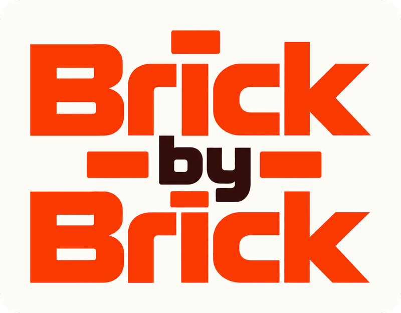
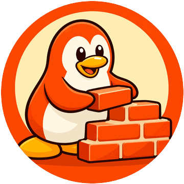
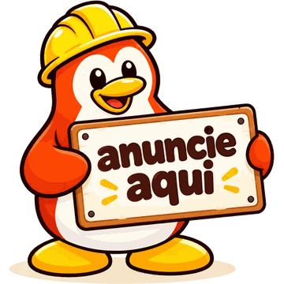

<strong>Aprenda Python construindo uma cidade, tijolo por tijolo.</strong>

## O que é

Brick by Brick é um jogo para aprender a programar em Python, do primeiro "olá, mundo" até classes e objetos. Você começa com um terreno vazio e uma cidade inteira para levantar: cada prédio é uma aula, e cada aula se constrói escrevendo código de verdade.

## Como se joga

Escolha uma obra no mapa da cidade. Lá dentro, cada pequeno desafio entrega alguns tijolos de código: encaixe os certos e a linha fica firme, virando uma fiada de tijolos no prédio. Linha a linha a parede sobe, até o telhado chegar e a obra ficar pronta.

Os tijolos se encaixam como peças de Tetris, a cidade se percorre como no Club Penguin, e o programa que você monta funciona de verdade, ali mesmo, sem instalar nada.

Errar faz parte da obra. Quando um tijolo não encaixa, o Guglo mostra o que aconteceu e explica o porquê, sem bronca. Às vezes o tijolo até funciona, mas existe um jeito melhor, e ele conta qual é. Acertar de primeira rende combo e estrelas.

## A cidade

Dez obras, espalhadas por três bairros, do básico ao avançado:

- **Vila do Alicerce** — Correio, Armazém, Mercado e Prefeitura: mostrar mensagens, guardar valores, fazer contas e conversar com quem usa o programa.
- **Centro** — Cinema, Fábrica e Biblioteca: tomar decisões, repetir tarefas e organizar listas.
- **Alto da Colina** — Oficina, Cofre e Construtora: criar as próprias funções, guardar dados por chave e desenhar plantas de objetos.

E ainda sobra terreno vazio esperando as próximas obras.

## Conheça o Guglo

Guglo é o pinguim pedreiro da cidade. Ele carrega os tijolos, sobe no andaime a cada fiada nova, comemora com você quando a linha encaixa e, quando algo dá errado, explica com paciência o que aconteceu.

## Por que um pinguim?

O Brick by Brick é uma homenagem a quem cresceu com os computadores que vinham com Linux, e com os joguinhos cheios de pinguins que moravam neles. Muita gente deu os primeiros cliques ali sem saber que estava diante de software livre: coisas feitas por pessoas que compartilhavam o que criavam, para que outras pudessem aprender, mudar e criar em cima.

Este projeto quer devolver um pouco disso.

## Livre para construir junto

O Brick by Brick é de código aberto e pode ser modificado por quem quiser: criar aulas novas, desenhar outros prédios, melhorar uma explicação ou levar o jogo para outro caminho. Se você também aprendeu com o que outras pessoas compartilharam, venha assentar alguns tijolos com a gente. O caminho para quem quer mexer está no [guia de contribuição](CONTRIBUTING.md).

## Anuncie aqui

O Brick by Brick é gratuito, tem código aberto e vai continuar crescendo com o tempo. Para ajudar a financiar o futuro da educação digital no Brasil, vamos abrir espaços para marcas, SaaS e web apps anunciarem dentro do jogo: um outdoor na cidade, o patrocínio de uma obra, a tela de carregamento do Python e o Guglo Wars. Sem rastrear quem estuda, nunca no meio de um exercício e sempre identificado como patrocinado. Para conversar, escreva para [castrotrindade2929@gmail.com](mailto:castrotrindade2929@gmail.com?subject=Quero%20anunciar%20no%20Brick%20by%20Brick).

## Licença

O código é livre sob a [AGPL-3.0](LICENSE), e as aulas, sob a [CC BY-SA 4.0](conteudo/LICENSE). Você pode usar, estudar, modificar e compartilhar, desde que o que nascer daqui continue aberto para todo mundo.
